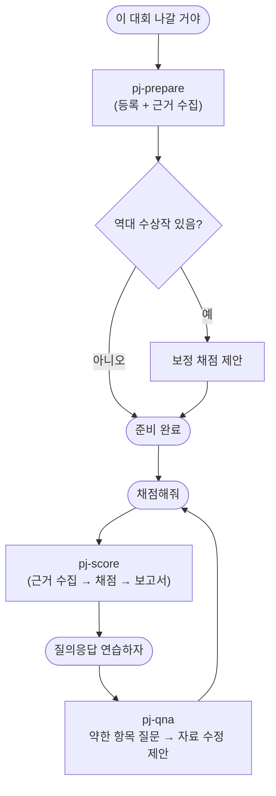

# skill 3개

설치하면 `pj-` skill 3개가 보인다. 이름을 몰라도 된다 — 말로 요청하면 맞는 skill이 불린다. `/pj-score`처럼 바로 불러도 된다.

| skill | 하는 일 | 이렇게 말하면 |
| --- | --- | --- |
| `pj-prepare` 대회 준비 | 대회 등록(점수표·심사위원·취지)과 근거 수집(자동·웹·질문, 근거 장부) | "이 대회 나갈 거야 <공고>", "자료 더 찾아줘", "뭐가 빠졌어" |
| `pj-score` 채점 | 자료 채점(독립 채점·합산·보고서)과 아이디어 비교(완벽히 구현했을 때의 상한 점수) | "몇 점이야", "다시 봐줘", "아이디어 중 뭐가 나아" |
| `pj-qna` 질의응답 | 약한 곳을 찌르는 질문과 판정, 예상 질문지 | "질의응답 연습하자", "예상 질문 뽑아줘" |

## 한 번의 흐름

